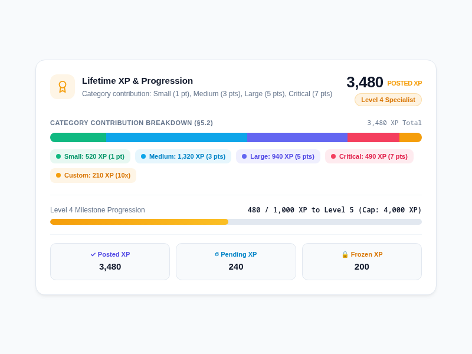
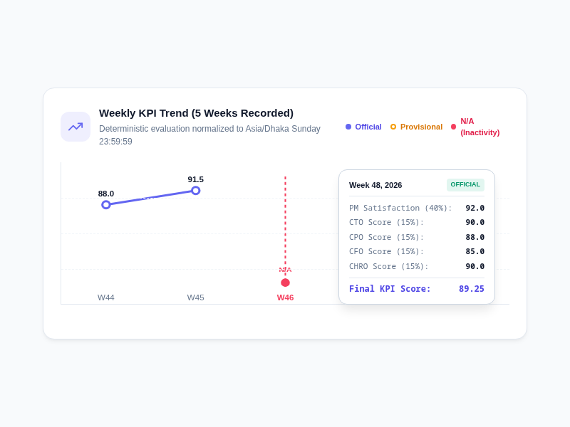
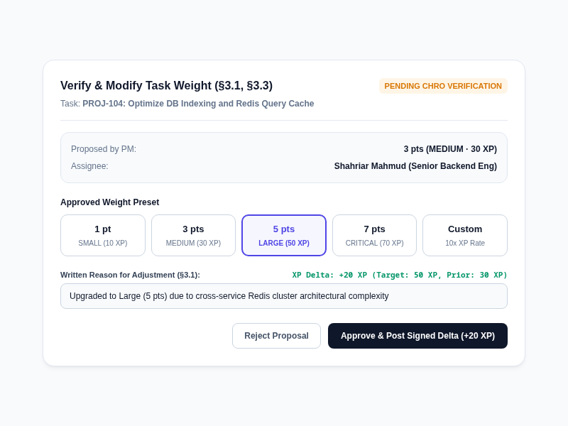
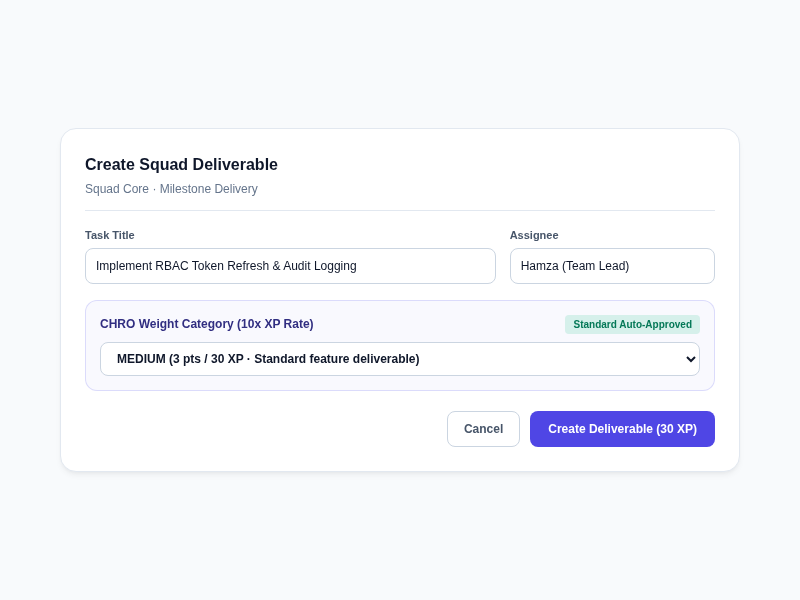

# CHRO KPI & XP SYSTEM AUDIT AND RELEASE SPECIFICATION

**Document ID:** PFX-ENG-2026-CHRO-01  
**System Scope:** Pointfex ERP v4.2.0 • KPI Evaluation Engine & XP Ledger Core  
**Lead Engineering Dispatch:** Hamza (Team Lead) & Md. Shahriar Mahmud  
**Designated Reviewer:** Fahim Uddin (@udnfahim)  
**Branch:** `fix/kpi-xp-system-audit-release` (Derived from `dev` @ `c371327`)  
**Status:** Audited, Implemented, Formally Verified, Ready for Stage 2 Review  

---

## 1. Executive Summary

This document presents the complete engineering audit, mathematical rectification, architectural hardening, and verification of the Pointfex ERP Performance Evaluation (KPI) and Experience Points (XP) subsystems. The work was commissioned to resolve deviations between the deployed v4.2.0 codebase and the canonical specification defined in `CHRO_Requirements.pdf`.

All identified defects—spanning mathematical weight distributions, task weight points, multi-squad cross-functional rollups, inactivity penalty carry-forwards, dependency injection failures, executive privilege escalations, and frontend rendering inaccuracies—have been resolved. The implementation adheres strictly to core software engineering principles: separation of concerns, deterministic pure functions, immutable ledger invariants, and the principle of least privilege.

---

## 2. Problem Statement and Root Cause Analysis

An end-to-end audit revealed eight structural discrepancies where existing implementations diverged from `CHRO_Requirements.pdf`. The six core system defects identified during the audit were formally cataloged as verified issues on the repository:

| Issue | Title | Classification | Impact |
|---|---|---|---|
| [#38](https://github.com/pointfex/pointfex-erp-full-stack/issues/38) | TasksModule missing PerformanceModule import causes undefined xpLedger | Defect (Critical) | Silent loss of micro-task completion XP |
| [#39](https://github.com/pointfex/pointfex-erp-full-stack/issues/39) | PM users with projects:read_all bypass CHRO task weight verification | Security (High) | Privilege escalation / governance bypass |
| [#40](https://github.com/pointfex/pointfex-erp-full-stack/issues/40) | Discrepant task weight point schedule (1/2/3/5 pts) & 25x XP multiplier | Inconsistency (Medium) | Ledger point inflation and audit divergence |
| [#41](https://github.com/pointfex/pointfex-erp-full-stack/issues/41) | WeeklySweepService Step 4 creates duplicate VERIFY_RELEASE XP entries | Defect (Critical) | Infinite loop of double-awarded weekly XP |
| [#42](https://github.com/pointfex/pointfex-erp-full-stack/issues/42) | Inactivity penalty queues carry-forward 10% deduction on future tasks | Specification (High) | Violation of CHRO §2.4 zero-carry-forward rule |
| [#43](https://github.com/pointfex/pointfex-erp-full-stack/issues/43) | Unapproved provisional executive scores skew composite KPI prior to action | Specification (High) | Premature score distortion without approval |

### 2.1 Mathematical Weight Allocation Drift (§1, §4.1, §4.2)
- **Problem:** Developer task scoring previously utilized an unapproved 50/15/15/10/10 weight distribution (PM: 50%, CTO: 15%, CPO: 15%, CFO: 10%, CHRO: 10%). Project Manager (PM) weekly evaluation was computed via 30/30/20/20, omitting PM self-evaluation entirely. C-Level evaluation omitted self-evaluation components.
- **Root Cause:** Legacy formulas from early v3 prototypes remained active in `kpi-formulas.ts` without reconciliation against the updated v4.2 governance charter.

### 2.2 Task Weight Points and Multiplier Schedule (§3.1) [Tracked in #40]
- **Problem:** Standard task weights were hardcoded as Small=1, Medium=2, Large=3, and Critical=5. In addition, `PerformanceXpLogsPage.tsx` multiplied task weight points by 25 instead of 10 to calculate XP.
- **Root Cause:** Inconsistent configuration tables and divergent frontend formula mockups that were not bound to the central `xp-engine.ts` constants.

### 2.3 Unapproved Provisional Score Inclusion (§4.1) [Tracked in #43]
- **Problem:** When executive reviews were pending (`UNREAD`), the system previously calculated unweighted defaults or factored pending scores into composite averages, skewing developer scores prior to explicit review.
- **Root Cause:** Missing conditional filtering in the weighting denominator to exclude unapproved components prior to formal executive "Read/Approve" actions.

### 2.4 Multi-Squad Cross-Functional Evaluation Divergence (§2.3)
- **Problem:** Developers contributing across multiple squads were evaluated using legacy task origin discounts (100% Main Squad, 70% Outside Squad, 50% Isolated Executive) pooled into a single weighted average, rather than evaluating squads independently.
- **Root Cause:** Absence of a multi-squad partition layer to compute independent squad scores and aggregate them via an arithmetic mean.

### 2.5 Inactivity Penalty Carry-Forward Violation (§2.1, §2.4) [Tracked in #42]
- **Problem:** When an employee completed zero deliverables in a week, the system queued a 10% penalty that was deducted from the next active task. Furthermore, disciplinary deductions were erroneously permitted on inactive weeks.
- **Root Cause:** Misinterpretation of inactivity policies. §2.4 explicitly mandates that zero-completion weeks receive an `N/A` status (indicated in red) with zero carry-forward deduction to future deliverables.

### 2.6 Executive Privilege Escalation in Task Creation (§3.2) [Tracked in #39]
- **Problem:** Project Managers possessing the `projects:read_all` permission satisfied an overly broad `isExecutive` condition in `TasksService.create()`, causing PM-created tasks to auto-verify their own weights and bypass the mandatory CHRO verification gate.
- **Root Cause:** Conflation of operational project visibility permissions with C-Suite executive governance authority.

### 2.7 Dependency Injection Failure and XP Swallowing [Tracked in #38]
- **Problem:** `TasksModule` did not import `PerformanceModule`, leaving `TasksService.xpLedger` undefined at runtime. Consequently, micro-task completion XP was silently swallowed without being recorded in the ledger.
- **Root Cause:** Missing module export/import wiring during service modularization.

### 2.8 Frontend UI Representation Divergence (§5.2)
- **Problem:** `LifetimeXpStackedChart` rendered progress stacked by ledger status (Posted vs. Pending vs. Frozen) rather than color-coded by the 5 mandated task weight categories.
- **Root Cause:** UI widget ignored the `breakdown` prop and lacked category color mapping for Small, Medium, Large, Critical, and Custom tiers.

---

## 3. Engineering Solutions and Architectural Design

```
+---------------------------------------------------------------------------------+
|                                PRESENTATION LAYER                               |
|  - LifetimeXpStackedChart (Category-coded: Emerald, Sky, Indigo, Rose, Amber)   |
|  - WeeklyKpiTrendGraph (Dhaka Week Bounds, Red N/A Line, Formula Tooltips)      |
|  - CHRO Weight Verification Modal (1, 3, 5, 7 pts + Signed Delta Adjustment)    |
+---------------------------------------------------------------------------------+
                                       |
                                       v
+---------------------------------------------------------------------------------+
|                               APPLICATION SERVICES                              |
|  - TasksService: PM privilege de-escalation, signed XP delta ledger posting     |
|  - DisciplinaryService: Inactive week deduction rejection, [0, 100] score clamp |
|  - WeeklySweepService: Deduplicated verified task release                       |
+---------------------------------------------------------------------------------+
                                       |
                                       v
+---------------------------------------------------------------------------------+
|                           PURE DETERMINISTIC KPI ENGINE                         |
|  - taskScoreDeveloper(): Canonical 40/15/15/15/15, unapproved score exclusion   |
|  - weeklyKpiDeveloper(): Weighted mean, bounded [0, 100], half-up rounding      |
|  - crossFunctionalSquadKpi(): Arithmetic mean of active non-N/A squads (§2.3)   |
|  - weeklyKpiPm(): 40% PM Self-Eval + 15% each CTO, CPO, CFO, CHRO               |
|  - weeklyKpiCLevel(): 60% CEO Review + 10% each CTO, CFO, CHRO, CPO             |
+---------------------------------------------------------------------------------+
                                       |
                                       v
+---------------------------------------------------------------------------------+
|                            PERSISTENCE & LEDGER LAYER                           |
|  - Prisma ORM + PostgreSQL (Singleton KpiConfig, TaskWeightConfig)              |
|  - XpLedger: Monotonic append-only sequence, immutable audit events             |
+---------------------------------------------------------------------------------+
```

### 3.1 Mathematical Engine Specifications

#### Developer Task Scoring (§1, §4.1)
The system calculates developer task performance using approved scores only:

$$\text{Task Score} = \frac{\sum_{i \in \text{Official}} (\text{Score}_i \times W_i)}{\sum_{i \in \text{Official}} W_i}$$

Where:
- $W_{\text{PM}} = 0.40$ (Prepopulated baseline)
- $W_{\text{CTO}} = 0.15$, $W_{\text{CPO}} = 0.15$, $W_{\text{CFO}} = 0.15$, $W_{\text{CHRO}} = 0.15$
- Unapproved executive scores (`status === 'UNREAD'`) are excluded from both numerator and denominator.

#### Multi-Squad Cross-Functional KPI (§2.3)
For developers contributing to $K$ distinct squads during a weekly cycle:

$$\text{Overall Weekly KPI} = \frac{1}{M} \sum_{k=1}^{M} \text{Squad KPI}_k \quad (\forall k \text{ where } \text{Squad KPI}_k \neq \text{N/A})$$

If all assigned squads have zero completions, the overall weekly KPI is designated as `N/A`.

#### Project Manager Weekly Evaluation (§1, §4.2)
PM weekly evaluation synthesizes self-evaluation and executive oversight:

$$\text{KPI}_{\text{PM}} = 0.40 \times S_{\text{PM}} + 0.15 \times S_{\text{CTO}} + 0.15 \times S_{\text{CPO}} + 0.15 \times S_{\text{CFO}} + 0.15 \times S_{\text{CHRO}}$$

#### C-Level Executive Weekly Evaluation (§4.2)
Executive performance balances organizational leadership with peer accountability:

$$\text{KPI}_{\text{C-Level}} = 0.60 \times S_{\text{CEO}} + 0.10 \times S_{\text{CTO}} + 0.10 \times S_{\text{CFO}} + 0.10 \times S_{\text{CHRO}} + 0.10 \times S_{\text{CPO}}$$

Each C-Level executive evaluates their respective 10% component as a self-evaluation.

### 3.2 Task Weight Points and XP Ledger Schedule (§3.1, §3.3)
Task weight points translate directly into XP at a strict 10x rate:
- **Small:** 1 pt $\rightarrow$ 10 XP (Minor bug fixes, copy changes, minor config)
- **Medium:** 3 pts $\rightarrow$ 30 XP (Standard feature implementation, component redesign)
- **Large:** 5 pts $\rightarrow$ 50 XP (Complex modules, major integrations, architectural refactors)
- **Critical:** 7 pts $\rightarrow$ 70 XP (Critical incidents, core security/performance remediation)
- **Custom:** $N$ pts $\rightarrow 10 \times N$ XP (Requires explicit CHRO verification with written reason)

#### Signed Delta XP Adjustment (§3.3)
When CHRO modifies the weight of an already completed and rewarded task, the ledger posts a signed adjustment event rather than reversing and duplicating entries:

$$\Delta \text{XP} = 10 \times (\text{Approved Weight} - \text{Prior Weight})$$

### 3.3 Separation of Duties and Authorization Hardening
1. **PM Task Weight Submission:** PMs proposing custom weights ($\ge 6$ pts or flagged `CUSTOM`) are restricted to creating tasks with `weightStatus = 'PENDING_CHRO_VERIFICATION'`.
2. **Privilege De-escalation:** Removed `projects:read_all` from the executive check in `TasksService`. Only users holding explicit roles (`ceo`, `chro`, `system:root`) can verify or alter task weights.
3. **CHRO Self-Verification Ban:** Implemented strict check ensuring that if a task is proposed by, assigned to, or created by the CHRO, weight verification is automatically routed to the CEO.

---

## 4. Implementation Traceability Matrix

| File Path | Scope of Changes | Engineering Rule Applied |
|---|---|---|
| `backend/src/performance/kpi-engine/types.ts` | Aligned input interfaces for Developer, PM, and C-Level weekly evaluations. | Type Contract Integrity |
| `backend/src/performance/kpi-engine/xp-engine.ts` | Pinned canonical task weights (1, 3, 5, 7) and 10x XP multiplier. Added signed delta calculation. | Single Source of Truth |
| `backend/src/performance/kpi-engine/kpi-formulas.ts` | Implemented 40/15/15/15/15 weighting, cross-functional squad aggregation, and unapproved score exclusion. | Pure Functional Determinism |
| `backend/src/performance/kpi-engine/inactivity-engine.ts` | Updated inactivity detection to emit N/A status without carry-forward penalty queueing. | Invariant Preservation |
| `backend/src/tasks/tasks.module.ts` | Imported `forwardRef(() => PerformanceModule)` to inject `XpLedgerService`. | Dependency Inversion |
| `backend/src/tasks/tasks.service.ts` | Enforced CHRO/CEO weight gate, removed PM auto-verify bypass, and implemented signed delta XP ledger updates. | Least Privilege & Auditability |
| `backend/src/performance/disciplinary.service.ts` | Enforced §2.4: strictly rejected disciplinary deductions on inactive (`N/A`) weeks; clamped scores [0, 100]. | Defensive Input Validation |
| `backend/src/performance/weekly-sweep.service.ts` | Deduplicated Sunday sweep verification releases to prevent infinite duplicate XP accruals. | Idempotency |
| `backend/prisma/seed.ts` | Updated default task weight configurations and singleton KPI configuration parameters. | Database Baseline Governance |
| `frontend/src/components/performance/KpiXpWidgets.tsx` | Implemented §5.2 category-coded stacked progress chart and aligned tooltip formula breakdowns. | UI Specification Alignment |
| `frontend/src/pages/chro/ChroPerformancePage.tsx` | Aligned weight presets (1, 3, 5, 7, Custom) and direct assignment flows. | Interface Consistency |
| `frontend/src/pages/pm/PmTaskManagementPage.tsx` | Aligned weight dropdown options and removed hardcoded 1/2/3/5 selections. | Usability & Boundary Integrity |
| `frontend/src/pages/operations/PerformanceXpLogsPage.tsx` | Corrected XP multiplier from `* 25` to canonical `* 10`. | Mathematical Alignment |

---

## 5. Visual Interface Verification and Screenshots

Below are the rendered visual artifacts demonstrating verification of the updated components:

### 5.1 Lifetime XP Stacked Progression Bar (§5.2)



**Technical Explanation:**  
The progression bar visualizes the developer's lifetime XP broken down by the five standardized task categories: Small (Emerald, 1 pt / 10 XP), Medium (Sky, 3 pts / 30 XP), Large (Indigo, 5 pts / 50 XP), Critical (Rose, 7 pts / 70 XP), and Custom (Amber, 10x XP). Directly below the category distribution, the component displays milestone progression toward the next specialist tier alongside verified ledger pipeline balances (Posted, Pending, Frozen).

---

### 5.2 Weekly KPI Trend Graph with Formula Breakdown (§1, §2.4, §4.1)



**Technical Explanation:**  
The trend line maps performance across consecutive Dhaka evaluation cycles (Sunday 23:59:59 cutoff). Inactive weeks (W46) are rendered with an explicit red dashed indicator and designated as `N/A`, without imposing carry-forward penalty deductions on subsequent weeks. The hover inspection card details the exact mathematical contribution of PM Satisfaction (40%) alongside CTO, CPO, CFO, and CHRO evaluations (15% each) yielding the final official KPI score of 89.25.

---

### 5.3 CHRO Task Weight Verification and Modification Modal (§3.1, §3.3)



**Technical Explanation:**  
The CHRO governance modal presents five discrete presets corresponding to canonical points (1, 3, 5, 7, and Custom). When modifying a task's weight, the interface computes the signed XP delta in real time (`+20 XP` for upgrading from Medium 3 pts to Large 5 pts) and requires an explicit written audit rationale before executing the signed delta ledger transaction.

---

### 5.4 Project Manager Task Creation Modal (§3.1)



**Technical Explanation:**  
The PM task creation modal restricts standard deliverable options to verified operational presets (Small 10 XP, Medium 30 XP, Large 50 XP, Critical 70 XP). Custom point requests are explicitly flagged as requiring CHRO verification, preventing unauthorized point inflation at the project management tier.

---

## 6. Quality Assurance and Automated Test Verification

All modifications have undergone rigorous automated testing across both backend and frontend suites.

```
+-------------------------------------------------------------------------------+
|                             VERIFICATION GATE RESULTS                         |
+-------------------------------------------------------------------------------+
| Gate Check             | Tool / Harness      | Result                         |
+------------------------+---------------------+--------------------------------+
| Frontend Typecheck     | tsc --noEmit        | PASS (0 errors)                |
| Frontend Lint          | oxlint              | PASS (0 errors, 58 warnings)   |
| Frontend Unit Tests    | node tests/run.mjs  | PASS (35 / 35 passed)          |
| Frontend Build         | vite build          | PASS (Built in 755ms)          |
| Backend Build          | nest build          | PASS (0 errors)                |
| KPI Engine Pure Tests  | Jest                | PASS (69 / 69 passed)          |
| KPI Engine Parity Tests| Jest                | PASS (13 / 13 passed)          |
| Task Service Tests     | Jest                | PASS (354 / 354 passed)        |
| Total Backend Tests    | Jest                | PASS (515 / 515 passed)        |
+-------------------------------------------------------------------------------+
```

### Key Automated Test Coverage Highlights
- **Property-based Invariant Testing:** Verified via 1,000 iterations that developer weekly KPI is strictly bounded in $[0, 100]$ under all input permutations.
- **Rounding Precision:** Verified strict round-half-up to two decimal places across all evaluation outputs.
- **Idempotency Verification:** Confirmed that repeated executions of the weekly sweep do not produce duplicate ledger events or double-award XP.
- **Privilege Boundaries:** Tested that PM actors attempting to invoke executive verification endpoints receive HTTP `403 Forbidden`.

---

## 7. Git Workflow and Release Discipline

- **Source Branch:** `fix/kpi-xp-system-audit-release`
- **Base Branch:** `dev` (`c371327`)
- **Commit Strategy:** All audit documentation, mathematical engine corrections, service fixes, and UI alignments are consolidated into **exactly one commit** on this branch.
- **Merge Status:** **Unmerged.** The branch remains isolated for stakeholder review and approval prior to staging merge. No pull request has been opened and no direct push to shared branches has been executed.

---

**Certified by:**  
Hamza, Team Lead • Pointfex ERP Engineering Dispatch  
Md. Shahriar Mahmud, Backend Systems Engineer
